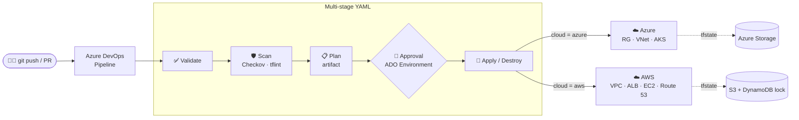

<p align="center">
  
</p>

<p align="center">
  <a href="https://github.com/N-Subramanya/terraform-ado-multicloud/actions/workflows/ci.yml"></a>
  
  
  
  
  
  
</p>

<p align="center">
  <b>One pipeline. Two clouds. Zero stored credentials.</b><br>
  Terraform for Azure and AWS, delivered through Azure DevOps multi-stage YAML pipelines with security scanning, plan review and approval gates.
</p>

---

## 🚀 Overview

This project deploys infrastructure to **Azure, AWS, or both** from a single Azure DevOps pipeline.
You pick the target `cloud`, the `environment` and the Terraform `action` when you start a run, so you never edit or commit YES/NO values to flip behaviour.
Every change goes through **validate → security scan → plan → manual approval → apply**.

Cloud access uses **workload identity federation** (Azure) and **OIDC** (AWS), so no access keys live in the repo or in tfvars files.

> 🚧 **Status:** structure and pipeline skeleton are in place; modules and stage templates are being implemented. See the [Roadmap](#️-roadmap).

## 🏗️ Architecture



## ✨ Features

| | Feature | Details |
|---|---|---|
| ☁️ | **Multi-cloud** | Separate `modules/azure` and `modules/aws`, selected by the `cloud` parameter |
| 🔐 | **No stored keys** | Workload identity federation and OIDC service connections, plus ADO variable groups |
| 🛡️ | **Shift-left security** | Checkov and tflint on every run, with results published to ADO |
| 👤 | **Gated deployments** | ADO Environments with approval checks before `prod` |
| 🎛️ | **Runtime parameters** | `cloud` · `environment` · `action` chosen at queue time |
| ♻️ | **Reusable templates** | Stage logic in `pipelines/templates/*.yml` |
| 🖼️ | **Golden images** | Packer-built AMI for the AWS compute tier |
| 🗄️ | **Remote state** | Azure Storage and S3 with DynamoDB locking, one state per env per cloud |

## 🔄 Pipeline Stages

| # | Stage | What happens |
|---|---|---|
| 1 | **Validate** | `terraform fmt -check`, `terraform init -backend=false`, `terraform validate` |
| 2 | **Scan** | Checkov and tflint, with results published to the ADO **Tests** tab |
| 3 | **Plan** | `terraform plan -out=tfplan`, with the plan published as a pipeline artifact |
| 4 | **Approve** | Manual approval check on the target ADO Environment |
| 5 | **Apply / Destroy** | Applies the reviewed plan or destroys, based on `action` |

### Run parameters

| Parameter | Values | Default |
|---|---|---|
| `cloud` | `azure` · `aws` · `both` | `azure` |
| `environment` | `dev` · `prod` | `dev` |
| `action` | `plan` · `apply` · `destroy` | `plan` |

## 🧰 Tech Stack

| Area | Tools |
|---|---|
| IaC | Terraform, Packer |
| CI/CD | Azure DevOps Pipelines (YAML), GitHub Actions (lint) |
| Clouds | Azure (VNet, AKS, Storage) · AWS (VPC, EC2, ALB, Route 53, S3, DynamoDB) |
| Security | Checkov, tflint, workload identity federation, OIDC |

## 📂 Project Structure

```text
terraform-ado-multicloud/
├── azure-pipelines.yml          # main pipeline: parameters + stages
├── pipelines/templates/         # validate · scan · plan · apply
├── modules/
│   ├── azure/                   # RG, VNet + subnets, NSG, AKS
│   └── aws/                     # VPC, subnets, IGW, EC2, ALB, Route 53
├── envs/
│   ├── dev/{azure,aws}/         # backend + tfvars per cloud
│   └── prod/{azure,aws}/
├── packer/                      # golden AMI template
├── docs/                        # architecture, ADO setup guide, screenshots
└── .github/workflows/ci.yml     # GitHub-side fmt/validate → CI badge
```

## ⚡ Quick Start

```bash
git clone git@github.com:N-Subramanya/terraform-ado-multicloud.git
cd terraform-ado-multicloud

# local check
terraform fmt -check -recursive
terraform -chdir=modules/azure init -backend=false && terraform -chdir=modules/azure validate
```

**In Azure DevOps:**
1. Create the service connections, variable group and environments. See [docs/ado-setup.md](docs/ado-setup.md).
2. Go to **Pipelines → New pipeline → GitHub** and select this repo. ADO picks up `azure-pipelines.yml`.
3. Click **Run pipeline** and choose `cloud`, `environment` and `action`.

## 📸 Screenshots

| Pipeline run | Approval gate | Checkov report |
|---|---|---|
| _coming soon_ | _coming soon_ | _coming soon_ |

## 🗺️ Roadmap

- [x] Repository structure and pipeline skeleton with runtime parameters
- [ ] Azure module: RG, VNet, NSG, AKS
- [ ] AWS module: VPC, subnets, ALB, EC2 (Packer AMI), Route 53
- [ ] Remote state backends for both clouds
- [ ] Validate, Scan, Plan and Apply stage templates
- [ ] ADO setup guide and screenshots
- [ ] Infracost cost estimate on PRs
- [ ] Scheduled drift detection

## 🙏 Acknowledgements

Inspired by the Azure DevOps + Terraform labs in [saikiranpi/Mastering-DevSecOps](https://github.com/saikiranpi/Mastering-DevSecOps), extended to multi-cloud with keyless authentication and security gates.

## 📄 License

[MIT](LICENSE) © Subramanya N
