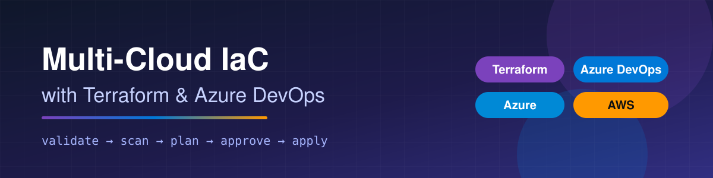
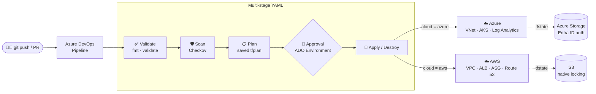

<p align="center">
  
</p>

<p align="center">
  <a href="https://github.com/N-Subramanya/terraform-ado-multicloud/actions/workflows/ci.yml"></a>
  
  
  
  
  
  
  
</p>

<p align="center">
  <b>One pipeline. Two clouds. Zero stored credentials.</b><br>
  Terraform for Azure and AWS, delivered through Azure DevOps multi-stage YAML pipelines with security scanning, plan review and approval gates.
</p>

---

## 🚀 Overview

A single Azure DevOps pipeline deploys infrastructure to **Azure, AWS, or both**.
You choose the `cloud`, the `environment` and the Terraform `action` when you queue a run. Every change goes through
**validate → security scan → plan → approval → apply**, and the apply stage runs **exactly the plan that was reviewed**.

| ☁️ Azure stack | ☁️ AWS stack |
|---|---|
| VNet + NSG, **AKS** (Azure CNI overlay, Calico, Entra ID RBAC, autoscaler, auto-upgrades), Log Analytics / Container Insights | VPC (3 public + 2 private subnets), NAT, **ALB → Auto Scaling group** in private subnets, Packer golden AMI, optional ACM + Route 53, KMS-encrypted flow logs |

Cloud access uses **workload identity federation** (Azure) and **OIDC** (AWS), so there are no secrets, access keys or storage keys anywhere.

## 🏗️ Architecture



More diagrams (keyless auth flow and per-cloud resources) are in [docs/architecture.md](docs/architecture.md).

## ✨ Features

| | Feature | Details |
|---|---|---|
| ☁️ | **Multi-cloud** | `modules/azure` and `modules/aws`, selected by the `cloud` parameter; `both` plans and applies in parallel |
| 🔐 | **No stored credentials** | Workload identity federation (Azure) and OIDC role (AWS); state accessed with Entra ID / IAM |
| 🛡️ | **Shift-left security** | Checkov on every run, published to the ADO **Tests** tab (151 passed, 0 failed); TFLint with Azure and AWS rule sets |
| 📋 | **Reviewed plans** | The plan is saved as an artifact, summarised on the run page, and applied as-is |
| 👤 | **Gated deployments** | ADO Environments (`dev`, `prod`) with approval checks on prod |
| 🎛️ | **Runtime parameters** | `cloud` · `environment` · `action`: no YES/NO commits to flip behaviour |
| ♻️ | **Reusable templates** | Stage logic in `pipelines/templates/`, with one `scripts/tf.sh` used by both the pipeline and local runs |
| 🖼️ | **Golden images** | Packer builds an encrypted, IMDSv2-only Amazon Linux 2023 + nginx AMI for AWS prod |
| 🗄️ | **Remote state** | Azure Storage (Entra ID only, versioned) and S3 (versioned, KMS, native lock files), one state per env per cloud |
| 🔒 | **Pinned toolchain** | Terraform 1.16.6, Checkov 3.3.29, provider lock files for Linux, Windows and macOS |

## 🔄 Pipeline

| # | Stage | What happens |
|---|---|---|
| 1 | ✅ **Validate** | Pinned Terraform install (SHA-256 verified), `fmt -check`, `init -backend=false` + `validate` for every stack |
| 2 | 🛡️ **Scan** | Checkov policy-as-code scan; JUnit results published to the **Tests** tab |
| 3 | 📋 **Plan** | Authenticate with OIDC, `init` with the remote backend, `plan -out=tfplan` (or `plan -destroy`); the plan is published as an artifact and summarised on the run |
| 4 | 👤 **Approve** | Deployment job on the ADO Environment; `prod` requires approval |
| 5 | 🚀 **Apply** | Downloads the reviewed `tfplan` and applies exactly that plan |

Pushes and PRs run stages 1–3 only. Stages 4–5 run when you queue the pipeline with `action = apply` or `destroy`.

| Parameter | Values | Default |
|---|---|---|
| `cloud` | `azure` · `aws` · `both` | `azure` |
| `environment` | `dev` · `prod` | `dev` |
| `action` | `plan` · `apply` · `destroy` | `plan` |

## 🧰 Tech Stack

| Area | Tools |
|---|---|
| IaC | Terraform 1.16 (azurerm 5.x, aws 6.x), Packer |
| CI/CD | Azure DevOps multi-stage YAML pipelines, GitHub Actions |
| Azure | VNet, NSG, AKS, Log Analytics, Storage |
| AWS | VPC, NAT, ALB, Auto Scaling, EC2, KMS, CloudWatch, ACM, Route 53, S3 |
| Quality & security | Checkov, TFLint (azurerm + aws rule sets), ShellCheck, provider lock files |

## 📂 Project Structure

```text
terraform-ado-multicloud/
├── azure-pipelines.yml              # main pipeline: parameters + stages
├── pipelines/templates/
│   ├── validate.yml · scan.yml      # step templates (no credentials)
│   ├── plan.yml · apply.yml         # job templates per cloud
│   └── terraform.yml                # cloud auth (WIF / OIDC) + scripts/tf.sh
├── modules/
│   ├── azure/                       # RG, VNet, NSG, AKS, Log Analytics
│   └── aws/                         # network · compute · alb · dns (ACM + Route 53)
├── envs/
│   ├── dev/{azure,aws}/             # backend + providers + tfvars + lock file
│   └── prod/{azure,aws}/
├── packer/                          # golden AMI (AL2023 + nginx)
├── scripts/
│   ├── tf.sh                        # init/plan/apply for any cloud/env
│   ├── install-terraform.sh         # pinned, checksum-verified install
│   └── bootstrap-*-state.sh         # one-time remote state setup
├── docs/                            # architecture + step-by-step ADO setup
├── .tflint.hcl
└── .github/workflows/ci.yml         # fmt · validate · tflint · checkov · packer · shellcheck
```

## ⚡ Quick Start

**Check it locally** (no cloud account needed):

```bash
git clone https://github.com/N-Subramanya/terraform-ado-multicloud.git
cd terraform-ado-multicloud

terraform fmt -check -recursive
for d in envs/*/*/; do terraform -chdir="$d" init -backend=false && terraform -chdir="$d" validate; done
```

**Deploy with Azure DevOps.** Full guide: [docs/ado-setup.md](docs/ado-setup.md)
1. Bootstrap the remote state: `scripts/bootstrap-azure-state.sh` and `scripts/bootstrap-aws-state.sh`.
2. Create the service connections `sc-azure-wif` and `sc-aws`, the variable group `vg-terraform-common`, and the environments `dev` / `prod`.
3. **Pipelines → New pipeline → GitHub** and select this repo, then **Run pipeline** with `cloud`, `environment` and `action`.

**Or run locally** after `az login` / `aws sso login`:

```bash
./scripts/tf.sh azure dev plan && ./scripts/tf.sh azure dev apply
```

## 🔐 Security

- **No long-lived credentials:** WIF / OIDC for the pipeline; state uses Entra ID (storage shared keys disabled) and IAM.
- **AKS:** Entra ID + Azure RBAC, local accounts off, Azure Policy, workload identity, Key Vault CSI, automatic patching.
- **AWS:** private web tier, IMDSv2 required, encrypted EBS, SSM instead of SSH, locked default security group, KMS-encrypted flow logs.
- **Policy as code:** Checkov gates every run. Accepted risks are documented inline as `#checkov:skip=<ID>:<reason>`, so the trade-offs are explicit and reviewable.

## 💰 Cost

Dev on both clouds costs roughly **USD 80–100 / month** if left running, mostly the AWS NAT gateway + ALB and one AKS node.
Queue the pipeline with `action = destroy` when you're done. More detail is in the [setup guide](docs/ado-setup.md#-cost-notes).

## 📸 Screenshots

| Pipeline run | Approval gate | Checkov report |
|---|---|---|
| _add after first run_ | _add after first run_ | _add after first run_ |

## 🗺️ Roadmap

- [x] Repository structure and pipeline with runtime parameters
- [x] Azure module: VNet, NSG, AKS, Log Analytics
- [x] AWS module: VPC, NAT, ALB, Auto Scaling (Packer AMI), ACM + Route 53, flow logs
- [x] Remote state backends for both clouds (Entra ID / S3 native locking)
- [x] Validate, Scan, Plan and Apply stage templates with saved-plan apply
- [x] ADO setup guide, architecture docs, GitHub Actions CI
- [ ] Infracost cost estimate on PRs
- [ ] Scheduled drift detection (nightly `plan -detailed-exitcode`)
- [ ] WAF + ALB access logs; private AKS cluster with self-hosted agents

## 📄 License

[MIT](LICENSE) © Subramanya N
