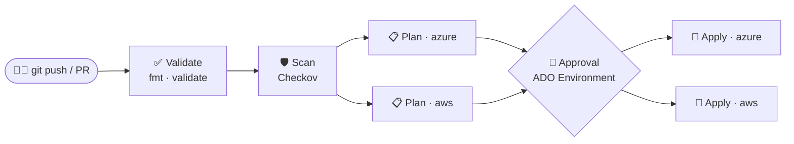
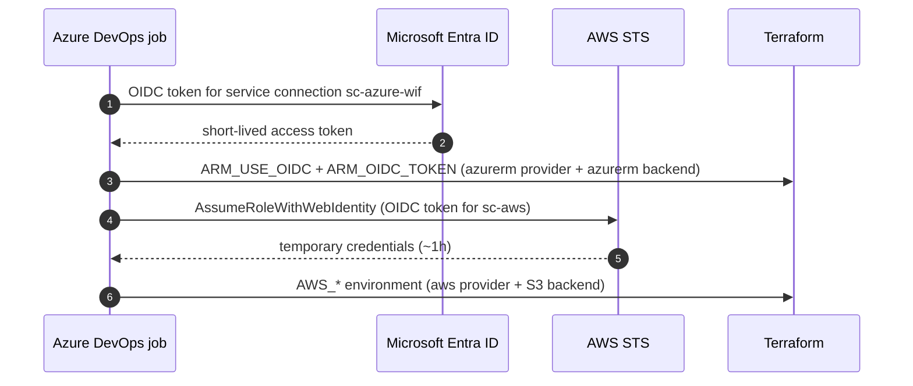
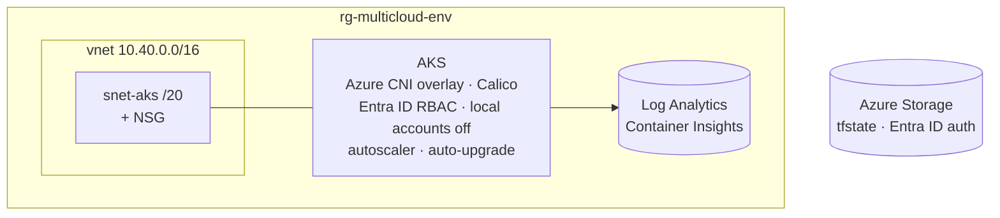
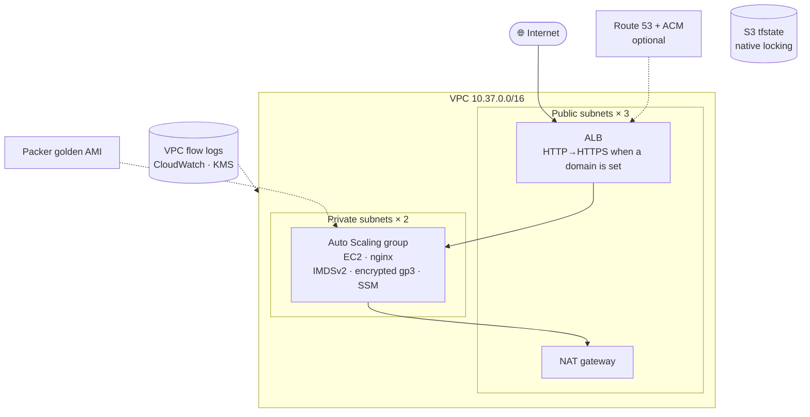

# Architecture

## Delivery flow

- **Validate** and **Scan** need no cloud credentials.
- **Plan** jobs run in parallel when `cloud = both`. Each one saves `tfplan` as an artifact and uploads a plan summary.
- **Apply** is a deployment job on the `dev` / `prod` ADO Environment, so approvals configured there gate it. It applies the *saved* plan, so what was reviewed is exactly what gets applied.

## Keyless authentication

No client secrets, access keys or storage account keys are stored anywhere: not in the repo, not in ADO.

## Azure stack (`modules/azure`)

| Resource | Hardening |
|---|---|
| AKS | Entra ID + Azure RBAC, local accounts disabled, Azure Policy add-on, workload identity, Key Vault CSI with secret rotation, patch auto-upgrade, node image auto-upgrade, image cleaner |
| Network | Azure CNI overlay, Calico network policy, NSG on the node subnet, optional API server IP allow-list |
| Observability | Container Insights to Log Analytics (30 days in dev, 90 in prod) |

## AWS stack (`modules/aws`)

| Resource | Hardening |
|---|---|
| VPC | Default security group locked (no rules), flow logs to KMS-encrypted CloudWatch (1-year retention), no public IPs on launch |
| Web tier | Private subnets only, reachable just from the ALB security group, IMDSv2 required, encrypted EBS, SSM Session Manager instead of SSH keys, detailed monitoring |
| ALB | Drops invalid headers, TLS 1.3 policy with ACM certificate, HTTP→HTTPS redirect, deletion protection in prod |

## Environments

| | dev | prod |
|---|---|---|
| AKS tier / nodes | Free · `B2s` · 1–2 | Standard (SLA) · `D2s_v5` · 2–5 |
| AWS web tier | `t3.micro` × 1 · Amazon Linux + user data | `t3.small` × 2–4 · Packer golden AMI |
| Approval | none | ADO Environment approval |
| State key | `dev/<cloud>.tfstate` | `prod/<cloud>.tfstate` |

## Security scanning

Checkov runs in both the ADO **Scan** stage and GitHub Actions: **151 checks passed, 0 failed**.
Accepted risks are documented next to the resource as `#checkov:skip=<ID>:<reason>`. Examples: a public AKS API server (instead of a private cluster) and no WAF in front of the ALB, both to keep this demo affordable.
